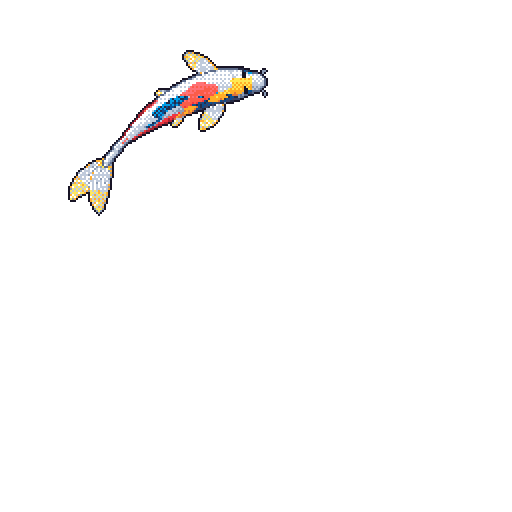
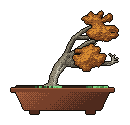

<picture>
  
</picture>

<picture>
  
</picture>
<picture>
  
</picture>

 
<a href="https://github.com/chechupv">
  <picture>
    <source media="(prefers-color-scheme: dark)" srcset="cards/stats-dark.svg">
    
  </picture>
</a>
<a href="https://github.com/chechupv?tab=repositories">
  <picture>
    <source media="(prefers-color-scheme: dark)" srcset="cards/languages-dark.svg">
    
  </picture>
</a>
 

  Final-year Computer Engineering student at UPV · Software Engineering · building projects with solid software architecture

  
  
  
  
  

  Koi by <a href="https://github.com/yalongwastaken/git-koi">git-koi</a> · bonsai by <a href="https://github.com/egorthinks/git-bonsai">git-bonsai</a> · layout inspired by <a href="https://github.com/yalongwastaken">@yalongwastaken</a>

